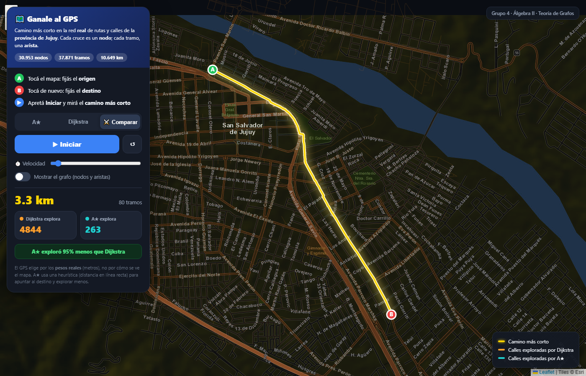

# Expo Minas — Grupo 1 · Grafos aplicados a la vida real

**Álgebra II — Eje temático: Teoría de Grafos**
Integrantes: Vargas Leonardo · Urzagaste Santiago · Jorqui Ignacio · Lamas Octavio

Modelamos la red de rutas y calles de la **provincia de Jujuy** como un grafo
ponderado y mostramos cómo un GPS (Google Maps, PedidosYa, etc.) encuentra el
**camino más corto** con los algoritmos de **Dijkstra** y **A\***.

## La app del stand — `app/index.html`

Una aplicación **web interactiva** sobre un **mapa real oscuro con nombres de
calles** (OpenStreetMap): **30 953 nodos, 37 871 tramos, 10 649 km**. Combina el
**detalle completo de Gran Jujuy** (todas las calles) con las **rutas de toda la
provincia**, así podés clickear en cualquier esquina de la ciudad o rutear entre
pueblos (San Salvador → La Quiaca). El público marca **dos puntos** y la app
dibuja el **camino más corto**, pintando en vivo las **calles que explora**
Dijkstra vs A★.

**Para abrirla:** doble clic en `app/index.html` (abre en cualquier navegador).

- **1er clic** = origen (A) · **2do clic** = destino (B)
- Elegí el modo (**A★**, **Dijkstra** o **Comparar**) y apretá **Iniciar**
- Cuando encuentra el camino, **lo ilumina** y opaca el resto para dar foco
- Regulá la **velocidad** de la animación · casilla “Mostrar el grafo” (nodos y aristas)
- Arrastrar = mover el mapa · Rueda del mouse = zoom · reiniciar con el botón

> El **mapa de fondo** (tiles) necesita internet. Si en el stand no hay conexión,
> abrí **`app/index_offline.html`**: dibuja la red sin mapa de fondo y funciona
> 100 % offline (mismo cálculo).



## Contenido

```
mm2/
├── README.md
├── app/                             <- LA APP INTERACTIVA DEL STAND
│   ├── index.html                      (abrir esto — mapa real, necesita internet)
│   ├── index_offline.html              (versión sin mapa de fondo, funciona offline)
│   ├── datos_jujuy.js                  (grafo real, generado de OSM)
│   └── vendor/                         (librería Leaflet, local)
├── informe/
│   ├── Informe_Grupo1.md            <- INFORME FORMAL (los 5 puntos de la consigna)
│   └── Informe_Grupo1.pdf           <- el informe en PDF
├── codigo/
│   ├── construir_datos_combinado.py <- arma el grafo de la app (ciudad + provincia)
│   ├── construir_datos_provincia.py <- variante: solo la provincia (Overpass)
│   ├── construir_datos_osm.py       <- variante: solo una ciudad (API oficial de OSM)
│   ├── red_real_osm.py              <- variante con la librería OSMnx
│   └── requirements.txt
└── figuras/
    └── app_ruta.png · app_versus.png   (capturas de la app)
```

## Regenerar el grafo desde OpenStreetMap

```bash
# baja ciudad (detalle) y provincia (rutas) con los scripts de descarga, y luego:
python codigo/construir_datos_combinado.py granjujuy.json provincia.json
```
Solo usa la librería estándar de Python. Vuelve a generar `app/datos_jujuy.js`.
