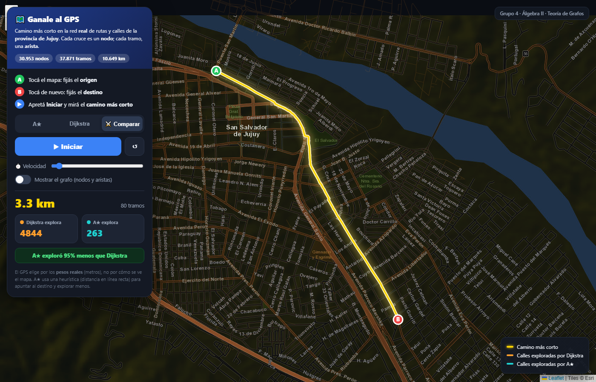
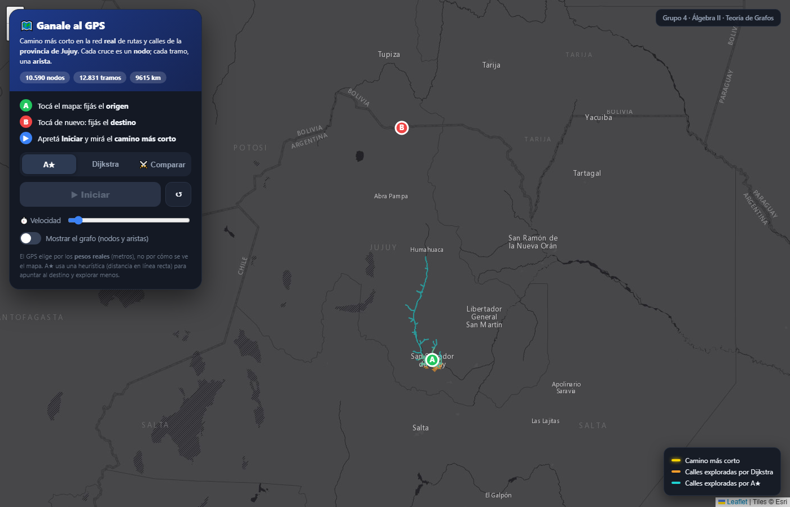

# Desafío Expo Minas — Entrega de Avance
## Modelo y Estructura Digital · *Grafos aplicados a la vida real*

---

## 1. Datos del Grupo

| | |
|---|---|
| **Grupo N.º** | 1 |
| **Eje temático** | **Teoría de Grafos** |
| **Materia** | Álgebra II |

**Integrantes (Apellido y Nombre):**

<div class="integrantes">
<figure><figcaption>Vargas,<br>Leonardo Alex Emir</figcaption></figure>
<figure><figcaption>Urzagaste,<br>Santiago Joaquín</figcaption></figure>
<figure><figcaption>Jorqui,<br>Ignacio Elías</figcaption></figure>
<figure><figcaption>Lamas Méndez,<br>Cristian Octavio</figcaption></figure>
</div>

**Tema elegido:** Grafos aplicados a la vida real — *cómo un GPS (Google Maps,
PedidosYa, Mercado Libre) encuentra el camino más corto sobre la red de calles
de San Salvador de Jujuy.*

---

## 2. Estructura Teórica Formal (Modelo Matemático)

### 2.1 Definición del sistema (problema real)

La **red de rutas y calles de la provincia de Jujuy** se modela como un **grafo
ponderado**. La pregunta real que resolvemos es la que resuelve un GPS decenas
de veces por segundo: *«dado un punto de origen y uno de destino, ¿cuál es el
recorrido de menor costo (distancia o tiempo) entre ambos?»*

La red real es la que usa la **app interactiva del stand** (`app/index.html`):
combina el **detalle completo de Gran Jujuy** (todas las calles, para rutear entre
esquinas) con las **rutas principales de toda la provincia** (para rutear entre
pueblos como Humahuaca o La Quiaca). Se descarga de OpenStreetMap vía Overpass y
se procesa con `construir_datos_combinado.py`.

| | Red real de la app (OpenStreetMap) |
|---|---|
| Vértices \|V\| | **30 953** |
| Aristas \|E\|  | **37 871** |
| Longitud total | **10 649 km** |

> *Nota:* el conteo exacto depende del área y de los tipos de vía incluidos.
> Empezamos (foro) con el microcentro de la capital (1012 nodos); la versión
> final combina ciudad + provincia: **30 953 nodos / 37 871 aristas / 10 649 km**.

Para **mostrar la teoría** (matriz de adyacencia, grados, propiedades) usamos un
**ejemplo pequeño** de 5 vértices: con 30 953 nodos la matriz no entra en una
hoja, pero las mismas definiciones valen a cualquier escala.

### 2.2 Conjuntos formales

Definimos el grafo

$$G = (V,\ E,\ w)$$

**no dirigido, simple, ponderado y conexo**, donde:

**Vértices** $V$ = conjunto de **esquinas / intersecciones** (cada tramo de calle
termina en una esquina):

$$V = \{v_0, v_1, \dots, v_{n-1}\}, \qquad |V| = n$$

**Aristas** $E$ = conjunto de **tramos de calle** que unen dos esquinas:

$$E \subseteq \big\{\, \{u,v\} : u,v \in V,\ u \neq v \,\big\}, \qquad |E| = m$$

**Función de peso** $w : E \to \mathbb{R}^{+}$, donde $w(\{u,v\})$ = **longitud
real del tramo en metros**. *(Variante usada para el GPS: $w$ = **tiempo de
viaje**, según la velocidad permitida — avenida vs. calle con semáforos.)*

### 2.3 Clasificación del grafo (propiedades teóricas)

| Propiedad | Valor | Justificación |
|---|---|---|
| **No dirigido** | sí | la mayoría de las calles son de doble mano: si se puede ir de $u$ a $v$, se puede volver. *(Las calles de mano única se modelan como un **dígrafo** con arcos $(u,v)$ — extensión del modelo.)* |
| **Simple** | sí | sin lazos ($\{v,v\}$) ni aristas múltiples entre el mismo par. |
| **Ponderado** | sí | cada arista tiene peso $w > 0$ (metros). |
| **Conexo** | sí | existe al menos un camino entre todo par de esquinas. |
| **Ralo (sparse)** | sí | $|E| \approx 1.2\,|V|$ y grado medio ≈ 2–3, típico de las redes viales planas. |

### 2.4 Matriz de adyacencia

Para un grafo de $n$ vértices, la matriz de adyacencia es
$A = (a_{ij}) \in \mathbb{R}^{n\times n}$ con

$$
a_{ij} =
\begin{cases}
 w(\{i,j\}) & \text{si } \{i,j\} \in E \\[2pt]
 0 & \text{si } \{i,j\} \notin E
\end{cases}
$$

Propiedades: es **simétrica** ($A = A^{\mathsf{T}}$, por ser no dirigido) y de
**diagonal nula** ($a_{ii}=0$, por ser simple).

**Ejemplo pequeño.** Tomamos un grafo $H$ de **5 vértices** $\{v_1,\dots,v_5\}$ y
**6 aristas**, con pesos en metros (ilustrativos):

$$E_H = \{\, v_1v_2,\ v_1v_3,\ v_2v_3,\ v_3v_4,\ v_3v_5,\ v_4v_5 \,\}$$

Su matriz de adyacencia (cada entrada = peso del tramo en metros; `0` = sin
arista directa):

```
      v1   v2   v3   v4   v5
v1     0  100  150    0    0
v2   100    0  120    0    0
v3   150  120    0  200  180
v4     0    0  200    0   90
v5     0    0  180   90    0
```

### 2.5 Grados de los nodos y Lema del Apretón de Manos

El **grado** $\deg(v)$ es la cantidad de aristas incidentes a $v$ (equivale al
número de entradas no nulas en la fila $v$ de la matriz). En el ejemplo $H$:

| $v$ | $v_1$ | $v_2$ | $v_3$ | $v_4$ | $v_5$ |
|---|---|---|---|---|---|
| $\deg(v)$ | 2 | 2 | **4** | 2 | 2 |

- **Grado máximo:** $\Delta(H) = 4$ (el vértice $v_3$, el más conectado).
- **Grado mínimo:** $\delta(H) = 2$.

**Lema del Apretón de Manos (Handshaking):**

$$\sum_{v \in V} \deg(v) = 2\,|E|$$

$$\underbrace{2+2+4+2+2}_{=\,12} \;=\; 2 \cdot 6 \;=\; 12 \quad\text{(verifica)}$$

**Corolario** (verificado): la cantidad de vértices de **grado impar** es par; en
$H$ los cinco vértices tienen grado par, es decir hay **0** de grado impar (y 0 es
par).

**Grado medio:**
$$\bar{d} = \frac{2|E|}{|V|} = \frac{2\cdot 6}{5} = 2.4$$

> En la **red real de la app**: $\sum \deg(v) = 2\cdot 37\,871 = 75\,742$ y
> $\bar{d} = \dfrac{2\cdot 37\,871}{30\,953} \approx 2.45$. El grado medio ≈ 2–3
> es coherente con una red vial donde abundan tramos (grado 2) y cruces.

### 2.6 Camino mínimo: Dijkstra y A\*

Un **camino** de $s$ a $t$ es una sucesión $s=v_0, v_1, \dots, v_k=t$ con
$\{v_i,v_{i+1}\}\in E$; su **peso** es $\sum_{i} w(\{v_i,v_{i+1}\})$. El
**camino mínimo** es el de menor peso total.

- **Dijkstra** — algoritmo *greedy* para pesos no negativos. Expande siempre el
  nodo no visitado de menor distancia acumulada: crece **como una onda en el
  agua**, en todas direcciones. Complejidad $O\big((|V|+|E|)\log|V|\big)$.

- **A\*** — usa $f(n) = g(n) + h(n)$, con $g(n)$ = costo real acumulado desde
  $s$ y $h(n)$ = **heurística** (estimación de lo que falta hasta $t$). Si $h$ es
  **admisible** —nunca sobreestima, $h(n)\le$ costo real a $t$— A\* garantiza el
  óptimo. Usamos $h$ = **distancia en línea recta** (euclídea en el modelo;
  **Haversine** en la red geográfica), que **siempre es $\le$ la distancia por
  las calles** ⇒ admisible. Así A\* **"apunta" al destino** y explora menos.

> *Dijkstra es el caso particular de A\* con $h\equiv 0$.*

**Resultado sobre la red real** (la que corre la app, 30 953 nodos), medido entre
esquinas de San Salvador de Jujuy:

| Trayecto en la ciudad | Distancia | Dijkstra explora | A\* explora | Ventaja de A\* |
|---|---|---|---|---|
| Ejemplo 1 | 3.3 km | **4 844** | **263** | **−95 %** |
| Ejemplo 2 | 5.0 km | **8 805** | **1 573** | **−82 %** |

El **camino óptimo es idéntico** en ambos algoritmos, pero A\* explora **muchísimas
menos** esquinas gracias a la heurística: por eso un GPS usa A\* y no fuerza bruta.
La app también **rutea entre pueblos de la provincia** (p. ej. San Salvador de
Jujuy → La Quiaca, **281 km**); en viajes tan largos la ventaja de A\* se reduce,
porque ambos algoritmos deben recorrer primero la densa trama urbana del origen.

### 2.7 "Más largo pero más rápido" (realismo del GPS)

Si en lugar de la **distancia** usamos como peso el **tiempo de viaje**
($\text{tiempo} = \text{distancia} / \text{velocidad}$), el camino mínimo puede
cambiar: una ruta que *parece* más larga en el mapa —por ejemplo, ir por una
**avenida**— puede ser **más rápida** que una más corta llena de semáforos. El
algoritmo decide por los **pesos reales**, no por cómo "se ve" el mapa a simple
vista: exactamente lo que hace un GPS cuando elige la "ruta más rápida".

---

## 3. Modelo Digital / Código

### 3.1 Gráfico / diagrama digitalizado

**App interactiva del stand** — mapa **real** de la **provincia de Jujuy**
(`app/index.html`). El usuario marca origen (A) y destino (B), elige el algoritmo
y aprieta **Iniciar**:



*Red real (30 953 nodos, 37 871 tramos) sobre **mapa oscuro con nombres de
calles**. Camino más corto dentro de San Salvador de Jujuy (3,3 km): cuando se
encuentra, el camino **se ilumina** y la exploración se opaca para dar foco.
Panel: **Dijkstra explora 4 844 esquinas, A\* solo 263 (−95 %)**.*



*Modo “Comparar”: cada algoritmo pinta las **calles que va cubriendo**. En
**cian**, A\* apunta derecho al destino; en **naranja**, Dijkstra se expande en
todas direcciones (la “onda”). Con los mismos pasos, A\* ya está mucho más cerca.*

### 3.2 Código fuente

Todo el código es **propio**:

- **`app/index.html`** — la **app interactiva** del stand. Muestra el **mapa real
  oscuro** de la provincia (OpenStreetMap, librería Leaflet) y dibuja encima el
  grafo, las **calles que explora** cada algoritmo y la ruta; detecta el nodo más
  cercano al clic e implementa **Dijkstra y A\*** *a mano* (con un *min-heap*
  propio), **animando** la exploración a velocidad regulable. Al hallar el camino,
  **lo ilumina** y opaca el resto. *(Incluye `app/index_offline.html`, versión sin
  mapa de fondo por si en el stand no hay internet.)*
- **`codigo/construir_datos_combinado.py`** — arma el grafo que usa la app: une el
  **detalle completo de Gran Jujuy** (todas las calles) con las **rutas de toda la
  provincia**, ambos de OpenStreetMap (Overpass). Simplifica a **intersecciones**
  (cruces = nodos, tramos = aristas con peso en metros reales), se queda con la
  componente conexa principal y exporta `app/datos_jujuy.js`. Solo usa la librería
  estándar. *(`construir_datos_provincia.py` y `construir_datos_osm.py` bajan,
  respectivamente, solo la provincia o solo una ciudad.)*
- **`codigo/red_real_osm.py`** — variante que usa la librería **OSMnx**.
- **`codigo/requirements.txt`** — dependencias de los scripts de Python.

**Núcleo del algoritmo de Dijkstra (implementación propia):**

```python
def dijkstra(G, origen, destino, peso="longitud"):
    dist = {n: math.inf for n in G.nodes}
    prev = {n: None for n in G.nodes}
    dist[origen] = 0
    pq = [(0, origen)]                      # cola de prioridad (min-heap)
    explorados, visto = 0, set()
    while pq:
        d, u = heapq.heappop(pq)            # nodo no visitado más cercano
        if u in visto:
            continue
        visto.add(u); explorados += 1
        if u == destino:
            break
        for v in G.neighbors(u):            # relajación de aristas
            nd = d + G[u][v][peso]
            if nd < dist[v]:
                dist[v] = nd; prev[v] = u
                heapq.heappush(pq, (nd, v))
    return reconstruir(prev, origen, destino), dist[destino], explorados
```

A\* es idéntico pero la prioridad es `g + h` con `h` = distancia en línea recta.

---

## 4. Análisis Crítico e Interacción con IA

### 4.1 Transcripción de la consulta a la IA generativa

Transcripción del hilo del foro de la cátedra (Grupo 1).

**Vargas, Leonardo — Prompt a la IA** *(16/10/2026)*
> Necesitamos que nos des una estructura sobre una exposición que vamos a hacer
> acerca de grafos aplicados a acciones de la vida real, ej.: cómo se aplican los
> grafos en Google Maps para encontrar el camino más corto; queremos que sea
> interactivo con el público.

**Respuesta de la IA** *(estructura propuesta, ~20 min)*
> 1. **Gancho inicial (2 min).** Preguntar al público: "¿Cómo sabe el celular
>    cuál es el camino más corto de su casa a la facultad?".
> 2. **¿Qué es un grafo? (3 min).** Nodos y aristas, con o sin peso: las esquinas
>    son nodos, las calles aristas y la distancia/tiempo el peso.
> 3. **Otras aplicaciones (3 min).** Redes sociales, internet, logística,
>    recomendaciones (Netflix/Spotify).
> 4. **El problema del camino más corto (4 min).** Dijkstra explora en todas
>    direcciones (como una onda en el agua); A\* "apunta" al destino con una
>    heurística y explora menos.
> 5. **Demo interactiva con mapa real (5 min).** El público elige origen y
>    destino, adivina el camino y después se corre el algoritmo; mostrar
>    Dijkstra vs. A\* lado a lado contando cuántos nodos explora cada uno.

**Urzagaste, Santiago** *(16/10/2026)*
> Para mejorar la interacción, que cada grupo de chicos pueda seleccionar un
> sector de la ciudad que conozcan.

**Jorqui, Ignacio** *(23/10/2026)*
> En la diapo de cierre, un código QR: subir a un Drive el link de la demo para
> que la prueben, y un PDF de 1 página con los conceptos clave (nodos, aristas,
> Dijkstra vs. A\*).

**Lamas, Octavio** *(23/10/2026)*
> Además de esquinas normales, mostrar rápido una ruta donde el camino que parece
> más largo en el mapa es en realidad el más rápido (por tener avenidas en vez de
> calles con semáforos). Así mostramos que los algoritmos no eligen por cómo se ve
> el mapa, sino calculando los **pesos reales** — un mensaje claro de cómo funciona
> de verdad un GPS.

**Jorqui, Ignacio** *(23/10/2026)*
> Propongo un desafío extra: elegir 4 puntos y pedirle a un voluntario que arme a
> ojo la ruta más corta para un repartidor que visita todos los lugares y vuelve
> al inicio; después corremos el algoritmo en vivo. Muestra la diferencia entre la
> intuición humana y el cálculo real de pesos en logística (como PedidosYa o
> Mercado Libre).

**Lamas, Octavio** *(23/10/2026)*
> No me parece una propuesta viable.

**Vargas, Leonardo** *(23/10/2026)*
> La propuesta es atractiva como dinámica, pero no la considero viable para esta
> demostración. El problema planteado corresponde al **problema del viajante**:
> buscar la ruta óptima entre todos los puntos requiere evaluar una cantidad de
> combinaciones que crece muy rápido a medida que se agregan destinos. Con cuatro
> puntos podría resolverse sin dificultad, pero el ejemplo sería demasiado simple
> para representar un caso real; además, cargar y configurar los puntos sumaría
> complejidad. Podríamos considerar una versión más acotada, presentada
> explícitamente como una simplificación del problema logístico.

**Vargas, Leonardo — Cambios en el proyecto** *(05/11/2026)*
> Salto a la red de calles REAL: la traza urbana de San Salvador de Jujuy bajada
> de OpenStreetMap (API de Overpass). Ahora cada esquina es un nodo (1012) y cada
> tramo de calle una arista (1541), con peso = la longitud real de la calle en
> metros (≈159 km en total).

### 4.2 Observaciones, errores y limitaciones detectados y **corregidos** por el equipo

| # | Lo que dio / sugirió la IA | Error o limitación detectada | Corrección aplicada por el equipo |
|---|---|---|---|
| **1** | Dinámica del **"repartidor que visita todos los puntos y vuelve"** como si fuera parte del problema del camino más corto. | **Error conceptual grave:** eso **NO** es el problema de camino mínimo (Dijkstra/A\*), sino el **Problema del Viajante (TSP)**, que es **NP-difícil**: para $n$ destinos hay $\frac{(n-1)!}{2}$ rutas posibles — crece **factorialmente**. Con 4 puntos solo hay 3 rutas (trivial y engañoso); con muchos puntos es inabordable en vivo. | Lo **descartamos** como estaba planteado (análisis de Leonardo, apoyado por Octavio). Lo reservamos, si se usa, como **versión acotada presentada explícitamente como una simplificación**, para no confundir TSP con camino mínimo. |
| **2** | Ejemplo con **5 esquinas dibujadas a mano** en el pizarrón. | Poco realista y poco "digital": no muestra que el modelo escala a una ciudad. | **Refactorizado a la red REAL** bajada de **OpenStreetMap** (Overpass), con peso = longitud real en metros. Empezó por la capital (1012 nodos) y la versión final combina ciudad + provincia: **30 953 nodos / 37 871 aristas / 10 649 km**. |
| **3** | Afirmación de que **"A\* siempre explora menos nodos que Dijkstra"**. | Es cierto **solo si la heurística es admisible**; con una heurística que sobreestime, A\* puede **perder la optimalidad**. La IA no aclaró esta condición. | Lo **verificamos con nuestro propio código** sobre la red real: usamos la distancia en línea recta (admisible) y medimos que A\* explora **muchísimos menos** nodos con el **idéntico** camino óptimo (p. ej. **263 vs 4 844**). Documentamos la condición de admisibilidad. |
| **4** | Estimación genérica de **"20 minutos"** y analogías prestadas. | Tiempo y ejemplos no ajustados a nuestro stand ni a nuestra ciudad. | Ajustamos tiempos y **aterrizamos los ejemplos a Jujuy** (barrios que el público conoce) y a empresas locales (PedidosYa, Mercado Libre). |

**Conclusión del uso crítico de IA:** la IA fue útil como **punto de partida**
para la estructura, pero el equipo tuvo que **corregir un error conceptual
central** (confundir camino mínimo con TSP), **elevar el nivel técnico** (red
real de OSM en lugar de un dibujo) y **validar empíricamente** sus afirmaciones
con código propio.

---

## 5. Propuesta para la Expo Minas  *(≤ 200 palabras)*

**«Ganale al GPS» — mapa interactivo de Jujuy.**

En una pantalla mostramos la red **real** de rutas y calles de **toda la
provincia de Jujuy**. El público **elige dos puntos que conozca** —su barrio, o
dos pueblos, como San Salvador → La Quiaca— y marca origen y destino. Antes de
correr, **desafiamos a un voluntario a adivinar** la ruta más corta con el dedo;
recién entonces apretamos **Iniciar** y corremos **Dijkstra y A\* lado a lado**,
pintando en vivo **las calles que explora cada uno** (la "onda" de Dijkstra
contra la flecha dirigida de A\*) hasta que **el camino se ilumina**. El golpe de
efecto es el **«camino tramposo»**: una ruta que *parece* más larga pero es más
**rápida** por ir en ruta/avenida — así mostramos que el GPS calcula **pesos
reales**, no apariencias. Para los más chicos, una **maqueta de nodos con hilos**
para "caminar" el grafo con la mano. Cierre con un **código QR** a la **demo
online** y a un **PDF de 1 página** con los conceptos clave (nodos, aristas,
peso, Dijkstra vs A\*).

*Objetivo:* que cada persona se vaya entendiendo **cómo piensa realmente un GPS**.

---

## 6. Proceso de desarrollo: problemas, cambios y mejoras

Esta bitácora resume **cómo evolucionó el proyecto**, qué problemas aparecieron y
cómo los resolvimos. Es evidencia directa del **trabajo real** y del **uso
crítico** (refactorización continua), no de una solución que salió bien a la
primera.

### 6.1 Evolución de la escala del grafo

| Versión | Qué era | Problema que encontramos | Qué hicimos |
|---|---|---|---|
| **v0** | Dibujo a mano de 5 esquinas (idea inicial de la IA) | Poco realista, no demuestra que el modelo escala | Bajar la red **real** de OpenStreetMap |
| **v1** | Microcentro de la capital (≈1 453 nodos) | Cobertura muy chica | Ampliar el área |
| **v2** | **Toda la provincia**, solo rutas principales (10 590 nodos) | Al clickear en una calle de barrio, caía en la **avenida más cercana** (faltaban las residenciales) | Agregar el detalle fino de la ciudad |
| **v3 (final)** | **Gran Jujuy completo** (todas las calles) **+ rutas de la provincia** → **30 953 nodos** | — | Se puede clickear **cualquier** calle y además rutear entre pueblos |

### 6.2 Problemas que resolvimos

| # | Problema | Causa | Solución |
|---|---|---|---|
| 1 | La IA mezcló **camino mínimo** con el **«repartidor que visita todos los puntos»** | Eso es el **Problema del Viajante (TSP)**, NP-difícil, no el camino mínimo | Lo descartamos/acotamos y lo explicamos como simplificación (ver §4) |
| 2 | El mapa de fondo mostraba **«Access blocked / 403»** | Los servidores de OpenStreetMap **bloquean** las apps que se abren como archivo local (política de uso de *tiles*) | Cambiamos de proveedor de mapa |
| 3 | El proveedor **CartoDB** pedía **API key** | Cambió su política | Usamos **Esri** (sin key) |
| 4 | Queríamos **mapa oscuro con nombres de calles**, pero el oscuro de Esri casi no tiene nombres | Las capas «dark» traen pocas etiquetas | Usamos el mapa de **calles** de Esri + un **filtro CSS** (`invert` + `hue-rotate`) que lo vuelve oscuro **manteniendo los nombres** |
| 5 | No se podía **hacer más zoom** | Las capas oscuras topaban en *zoom* 16 | Proveedor que llega a *zoom* 19 |
| 6 | Con 30 953 nodos, **se trababa al mover** el mapa | Reproyectar 30k nodos en cada *frame* de paneo | Proyectamos en **coordenadas de capa** (solo al cambiar el *zoom*) y en cada *frame* aplicamos un simple desplazamiento |

### 6.3 Decisiones técnicas propias

- **Dijkstra y A\* implementados a mano**, con un **min-heap propio** (no una
  librería), para *entender* los algoritmos, **contar los nodos explorados** y
  **animar** la búsqueda.
- **Validación cruzada**: corrimos el mismo cálculo en **Python**, en **Node** y
  en la **app**; los resultados (distancia y nodos explorados) **coinciden
  exactamente**. Así nos aseguramos de que la implementación es correcta.
- **Heurística admisible** en A\* (distancia en línea recta / Haversine): nunca
  sobreestima, por eso A\* **sigue dando el óptimo** mientras explora menos.

### 6.4 Mejoras visuales para el stand (iteración con el grupo)

Botón **Iniciar** · colores **bien distintos** en el versus (naranja Dijkstra /
cian A\*) · se **pintan las calles cubiertas** (no solo los nodos) · al hallar el
camino **se ilumina** y el resto se **opaca** para dar foco · **control de
velocidad** de la animación · **versión offline** de respaldo por si falla la wifi.

### 6.5 Herramientas usadas

- **Datos:** OpenStreetMap (API oficial + **Overpass**).
- **App:** HTML + **Canvas** + **Leaflet**, JavaScript puro (sin *frameworks*).
- **Scripts:** **Python** (solo librería estándar para descargar y armar el
  grafo; `networkx`/`matplotlib` únicamente en la variante con OSMnx).

---

### Autoevaluación según la rúbrica

| Criterio | Pts | Evidencia en esta entrega |
|---|---|---|
| **Matemático** | 30 | §2: definición formal $G=(V,E,w)$, matriz de adyacencia, grados, **Lema del Apretón de Manos verificado**, propiedades, Dijkstra/A\* con admisibilidad. |
| **Implementación digital** | 30 | §3: **app interactiva** sobre mapa real (ciudad + provincia, **30 953 nodos / 37 871 aristas**), Dijkstra y A\* a mano con *min-heap* propio, animación de la exploración y camino que se ilumina, figuras generadas. |
| **Uso crítico de IA** | 20 | §4: transcripción + **4 correcciones documentadas** (incluye el error TSP vs. camino mínimo). |
| **Propuesta Expo** | 20 | §5: dinámica interactiva, maqueta, "camino tramposo", QR + PDF. |
